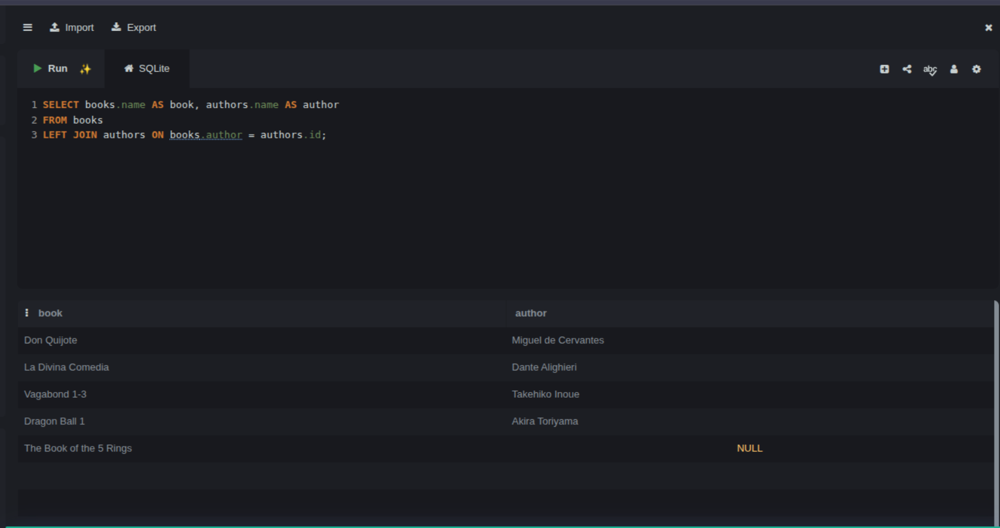
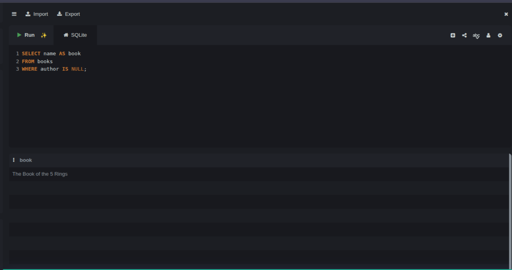
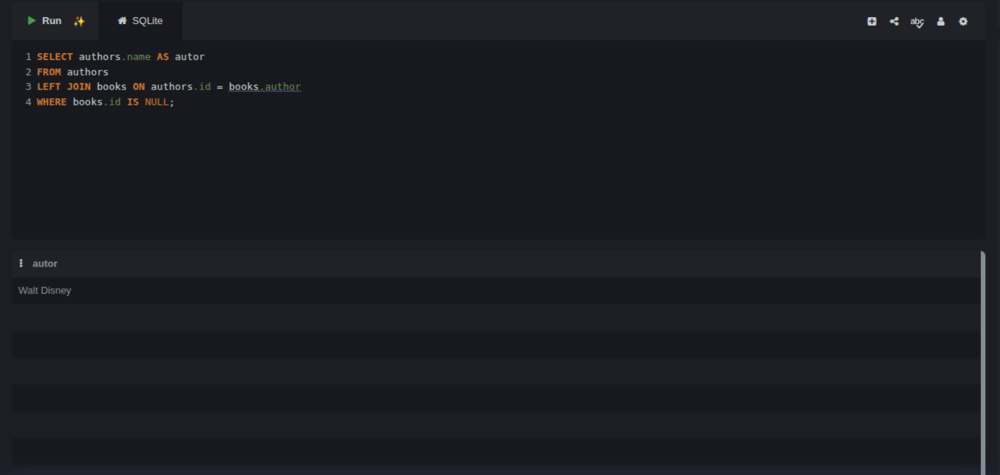
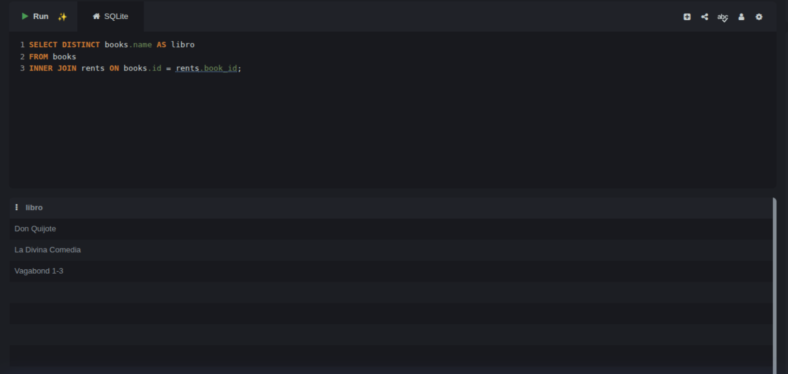
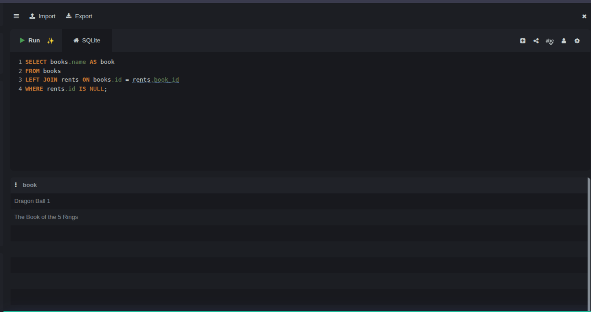
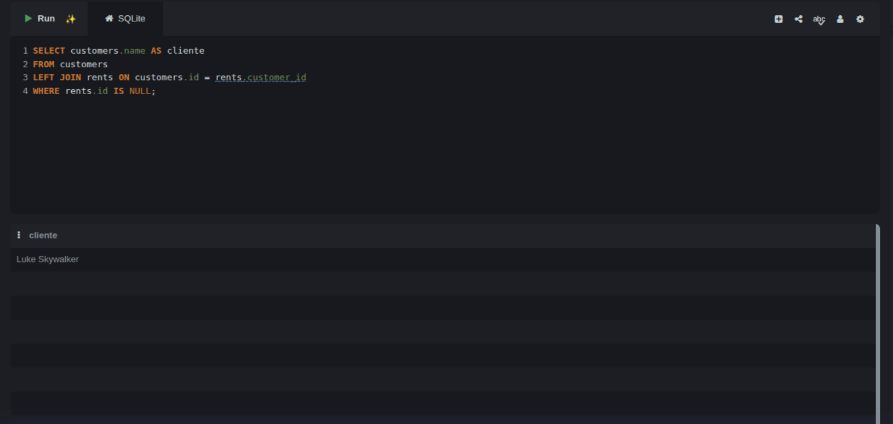
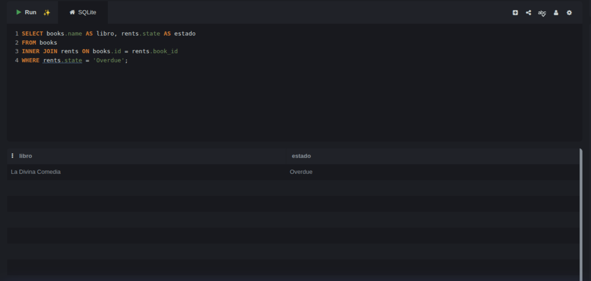

# Ejercicios de Conjuntos y JOINs

**Autor:** David Jiménez
**Módulo:** Bases de Datos

---

## 1. Teoría de Conjuntos

Conjuntos utilizados:

- `All = {1,2,3,4,5,6,7,8,9,10}`
- `Even = {2,4,6,8,10}`
- `Odd = {1,3,5,7,9}`

| Operación | Resultado | Explicación |
|---|---|---|
| **Even U Odd** | {1,2,3,4,5,6,7,8,9,10} | La unión junta todos los elementos de ambos conjuntos. Pares + impares = All. |
| **Even ∩ Odd** | { } (∅) | La intersección son los elementos comunes. Ningún número es par e impar a la vez → conjunto vacío. |
| **All - Odd** | {2,4,6,8,10} | La diferencia quita de All los impares; quedan los pares. |
| **C(Even)** | {1,3,5,7,9} | El complemento es todo lo de All que NO está en Even: los impares. |
| **C(Odd - All)** | {1,2,3,4,5,6,7,8,9,10} | Paso 1: `Odd - All = { }` (todos los impares están en All). Paso 2: el complemento del conjunto vacío es el universo completo (All). |

---

## 2. Funcionalidades del SELECT

| Funcionalidad | Qué hace | Ejemplo |
|---|---|---|
| **ORDER BY** | Ordena los resultados por una o más columnas. `ASC` = ascendente (por defecto), `DESC` = descendente. | `SELECT * FROM books ORDER BY name ASC;` |
| **LIMIT** | Limita la cantidad de filas que devuelve la consulta. | `SELECT * FROM books LIMIT 3;` |
| **GROUP BY** | Agrupa las filas que comparten un mismo valor. Se usa con funciones de agregación (`COUNT`, `SUM`, `AVG`, `MAX`, `MIN`). | `SELECT author, COUNT(*) FROM books GROUP BY author;` |
| **INNER JOIN** | Devuelve solo las filas que tienen coincidencia en **ambas** tablas. | `SELECT * FROM books INNER JOIN authors ON books.author = authors.id;` |
| **LEFT JOIN** | Devuelve **todas** las filas de la tabla izquierda y las coincidencias de la derecha. Si no hay coincidencia, rellena con `NULL`. | `SELECT * FROM books LEFT JOIN authors ON books.author = authors.id;` |
| **RIGHT JOIN** | Devuelve **todas** las filas de la tabla derecha y las coincidencias de la izquierda. Si no hay coincidencia, rellena con `NULL`. | `SELECT * FROM books RIGHT JOIN authors ON books.author = authors.id;` |

> **Patrón útil:** para encontrar "X que NO tienen Y" se usa `FROM X LEFT JOIN Y ... WHERE Y.id IS NULL`.

---

## 3. Ejercicios de JOINs

### Creación de las tablas

```sql
CREATE TABLE authors (id INTEGER PRIMARY KEY, name VARCHAR(100));
CREATE TABLE books (id INTEGER PRIMARY KEY, name VARCHAR(100), author INTEGER);
CREATE TABLE customers (id INTEGER PRIMARY KEY, name VARCHAR(100), email VARCHAR(100));
CREATE TABLE rents (id INTEGER PRIMARY KEY, book_id INTEGER, customer_id INTEGER, state VARCHAR(20));

INSERT INTO authors VALUES
(1,'Miguel de Cervantes'),(2,'Dante Alighieri'),(3,'Takehiko Inoue'),(4,'Akira Toriyama'),(5,'Walt Disney');

INSERT INTO books VALUES
(1,'Don Quijote',1),(2,'La Divina Comedia',2),(3,'Vagabond 1-3',3),(4,'Dragon Ball 1',4),(5,'The Book of the 5 Rings',NULL);

INSERT INTO customers VALUES
(1,'John Doe','j.doe@email.com'),(2,'Jane Doe','jane@doe.com'),(3,'Luke Skywalker','darth.son@email.com');

INSERT INTO rents VALUES
(1,1,2,'Returned'),(2,2,2,'Returned'),(3,1,1,'On time'),(4,3,1,'On time'),(5,2,2,'Overdue');
```

### 3.1 Todos los libros y sus autores (en caso de tenerlos)

Se usa `LEFT JOIN` para incluir también los libros sin autor.

```sql
SELECT books.name AS book, authors.name AS author
FROM books
LEFT JOIN authors ON books.author = authors.id;
```



### 3.2 Libros que no tienen autor

```sql
SELECT name AS book
FROM books
WHERE author IS NULL;
```



### 3.3 Autores que no tienen libros

Se traen todos los autores con `LEFT JOIN` y se filtran los que no tienen libro (`NULL`).

```sql
SELECT authors.name AS author
FROM authors
LEFT JOIN books ON authors.id = books.author
WHERE books.id IS NULL;
```



### 3.4 Libros que han sido rentados en algún momento

Se usa `INNER JOIN` (solo coincidencias) y `DISTINCT` para no repetir libros rentados varias veces.

```sql
SELECT DISTINCT books.name AS book
FROM books
INNER JOIN rents ON books.id = rents.book_id;
```



### 3.5 Libros que nunca han sido rentados

```sql
SELECT books.name AS book
FROM books
LEFT JOIN rents ON books.id = rents.book_id
WHERE rents.id IS NULL;
```



### 3.6 Clientes que nunca han rentado un libro

```sql
SELECT customers.name AS customer
FROM customers
LEFT JOIN rents ON customers.id = rents.customer_id
WHERE rents.id IS NULL;
```



### 3.7 Libros rentados en estado "Overdue"

```sql
SELECT books.name AS book, rents.state AS state
FROM books
INNER JOIN rents ON books.id = rents.book_id
WHERE rents.state = 'Overdue';
```


